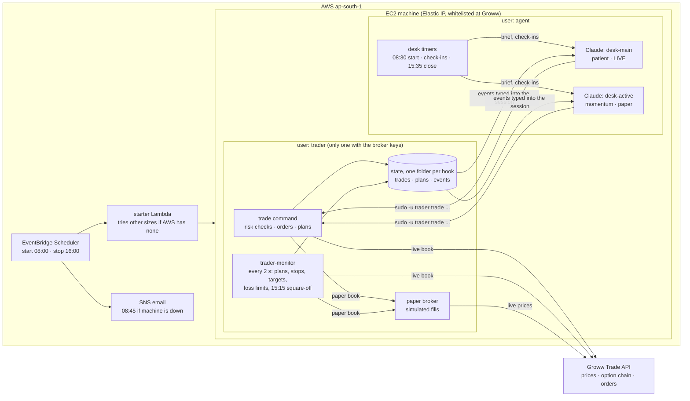

# groww-trader

Risk-checked intraday index-option trading (NIFTY, BANKNIFTY, SENSEX) for a Claude agent, on one EC2 machine in ap-south-1.

- `trader/`: the `trade` command. `engine.py` holds the order handling and risk rules, `brokers/` the broker adapters (Groww, plus paper trading on live prices), and `review.py` the results by setup.
- `config.yaml`: capital, loss limits, entry window, instruments. The live copy is `/opt/trader/config.yaml`; setup never overwrites it.
- `deploy/`: machine setup. It creates the `trader` and `agent` users, the sudoers rule, the monitor service, the Claude session timers (`desk`), and Claude's instructions (`desk/CLAUDE.md`).

## How it fits together



The agents decide; the program enforces. Claude can only act through `trade`, which checks every entry against the book's limits and places a stop order at Groww with it. The monitor keeps watching when Claude isn't looking.

| Time (IST, Mon-Fri) | What happens |
|---|---|
| 08:00 | Machine starts (other sizes if AWS has none of the usual one) |
| 08:30 | Each agent gets its morning brief: notes, research, today's plan |
| 08:45 | Email to the owner if the machine is still down |
| 09:20 | Entry window opens; check-ins every 5 minutes while busy, otherwise every 15 |
| 15:00 | No new entries |
| 15:15 | Monitor sells anything still open |
| 15:35 | Agents write results and lessons |
| 15:55 / 16:00 | Sessions end, machine stops |

- **`trader` user:** the only user that can read the broker keys (`/etc/trader/secrets.env`) and place orders.
- **`agent` user:** Claude runs here, one tmux session `desk-<book>` per agent, and can only trade through `trade` (`sudo -u trader`). It cannot change the config or the code.
- **`trader-monitor` service:** every 2 seconds it fires planned entries and watches stops and targets. It sells everything at the square-off time and stops trading when a loss limit is hit.
- **Event messages:** each book's monitor events go to `/var/lib/trader/books/<book>/events.jsonl`, and `desk watch` types them into that agent's session.

## Books: one per agent

`books:` in `config.yaml` lists the agents. Each book has its own capital and limits (overrides on top of the shared settings), state in `/var/lib/trader/books/<book>/`, a desk folder (`/home/agent/desk` for `main`, `/home/agent/desk-<book>` for the others), a tmux session `desk-<book>`, and a personality in `deploy/desk/personas/<book>.md`, appended to the shared `deploy/desk/RULES.md` to make that desk's `CLAUDE.md`.

```
trade review --all        # all books side by side, plus the total
trade status --all
desk list                 # sessions
desk attach active        # watch one (Ctrl-b d to leave it running)
```

To add a book: add it under `books:` in `/opt/trader/config.yaml`, write `deploy/desk/personas/<book>.md`, and rerun setup.

## Machine schedule (AWS)

EventBridge Scheduler, Asia/Kolkata, Mon-Fri. `groww-trader-start` runs the starter function (`deploy/aws/starter.py`) every 15 minutes from 08:00 to 09:45. If AWS has no spare machine of the usual size (t4g.medium), it switches the stopped machine to the next arm64 size in its list and tries again; the next morning it tries t4g.medium first. `groww-trader-check` emails the owner at 08:45 if the machine is still down. `groww-trader-stop` stops it at 16:00. Install or update: `bash deploy/aws/install-starter.sh <email>`.

## Install or update on the machine

```
rsync -a --exclude .git ./ ubuntu@<host>:trader-src/
ssh ubuntu@<host> 'cd trader-src && /opt/trader/.venv/bin/python tests/test_engine.py && sudo bash deploy/setup.sh'
```

## Before switching `mode: live`

Run `trade live-check --yes` in market hours: one real 1-lot round trip through the broker. Then set `capital` to the real account balance.
