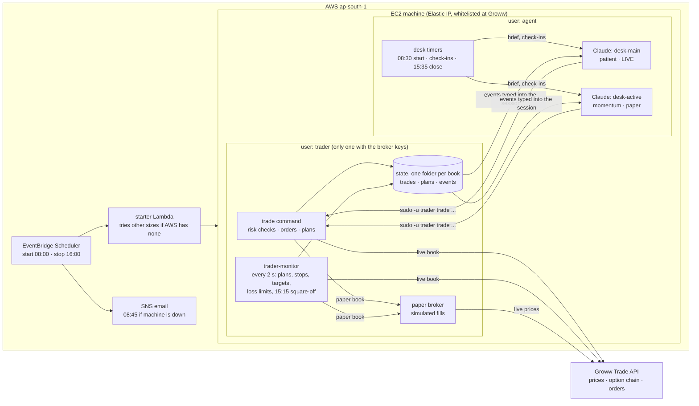

# agent-desk

Claude Code agents that trade Indian index options (NIFTY, BANKNIFTY, SENSEX) intraday through the Groww Trade API, inside hard risk limits they cannot change. It runs on one small AWS machine in Mumbai, on weekdays only.

- **The agents decide:** each agent is a Claude Code session with its own personality, capital and limits (a "book"). It researches, backtests on months of candles, writes a plan, and places planned entries.
- **The program enforces:** every order goes through the `trade` command, which checks it against the book's limits and places a stop-loss order at the broker with every entry. A monitor watches stops, targets, loss limits and the 15:15 square-off every 2 seconds, whether or not the agent is looking.
- **Paper first:** books start in paper mode (live prices, simulated fills). Going live is a config change per book.

**To set it up yourself, follow [SETUP.md](SETUP.md).** Read the [disclaimer](#disclaimer) first.


- `trader/`: the `trade` command. `engine.py` holds the order handling and risk rules, `brokers/` the broker adapters (Groww, plus paper trading on live prices), and `review.py` the results by setup.
- `config.yaml`: capital, loss limits, entry window, instruments. The live copy is `/opt/trader/config.yaml`; setup never overwrites it.
- `deploy/`: machine setup. It creates the `trader` and `agent` users, the sudoers rule, the monitor service, the Claude session timers (`desk`), and Claude's instructions (`desk/CLAUDE.md`).

## How it fits together



The agents decide; the program enforces. Claude can only act through `trade`, which checks every entry against the book's limits and places a stop order at Groww with it. The monitor keeps watching when Claude isn't looking.

| Time (IST, Mon-Fri) | What happens |
|---|---|
| 08:00 | Machine starts (other sizes if AWS has none of the usual one) |
| 08:30 | Each agent gets its morning brief: notes, research, today's plan |
| 08:45 | Email to the owner if the machine is still down |
| 09:20 | Entry window opens; check-ins every 5 minutes while busy, otherwise every 15 |
| 15:00 | No new entries |
| 15:15 | Monitor sells anything still open |
| 15:35 | Agents write results and lessons |
| 15:55 / 16:00 | Sessions end, machine stops |

- **`trader` user:** the only user that can read the broker keys (`/etc/trader/secrets.env`) and place orders.
- **`agent` user:** Claude runs here, one tmux session `desk-<book>` per agent, and can only trade through `trade` (`sudo -u trader`). It cannot change the config or the code.
- **`trader-monitor` service:** every 2 seconds it fires planned entries and watches stops and targets. It sells everything at the square-off time and stops trading when a loss limit is hit.
- **Event messages:** each book's monitor events go to `/var/lib/trader/books/<book>/events.jsonl`, and `desk watch` types them into that agent's session.

## Books: one per agent

`books:` in `config.yaml` lists the agents. Each book has its own capital and limits (overrides on top of the shared settings), state in `/var/lib/trader/books/<book>/`, a desk folder (`/home/agent/desk` for `main`, `/home/agent/desk-<book>` for the others), a tmux session `desk-<book>`, and a personality in `deploy/desk/personas/<book>.md`, appended to the shared `deploy/desk/RULES.md` to make that desk's `CLAUDE.md`.

```
trade review --all        # all books side by side, plus the total
trade status --all
desk list                 # sessions
desk attach active        # watch one (Ctrl-b d to leave it running)
```

To add a book: add it under `books:` in `/opt/trader/config.yaml`, write `deploy/desk/personas/<book>.md`, and rerun setup.

## Machine schedule (AWS)

EventBridge Scheduler, Asia/Kolkata, Mon-Fri. AWS names start with `DESK_NAME` (default `agent-desk`). `agent-desk-start` runs the starter function (`deploy/aws/starter.py`) every 15 minutes from 08:00 to 09:45. If AWS has no spare machine of the usual size (t4g.medium), it switches the stopped machine to the next arm64 size in its list and tries again; the next morning it tries t4g.medium first. `agent-desk-check` emails the owner at 08:45 if the machine is still down. `agent-desk-stop` stops it at 16:00. Install or update: `bash deploy/aws/install-starter.sh <instance-id> <email>`; the machine itself: `deploy/aws/create-machine.sh`.

## Security model

Claude runs with permission prompts turned off (`--dangerously-skip-permissions`), so it can work unattended. What contains it is the operating system, not Claude:

- **Separate users.** Claude runs as `agent`. The broker keys (`/etc/trader/secrets.env`) are readable only by `trader`, and orders are placed only by `trader`.
- **One narrow sudo rule.** `agent` may run exactly `/opt/trader/.venv/bin/python -m trader ...` as `trader`, and nothing else as anyone else.
- **Root-owned code and config.** `agent` cannot edit the program or the limits in `/opt/trader/config.yaml`. Owner-only commands (`trade admin`, `live-check`) refuse to run for `agent`. Its instructions (`CLAUDE.md`) are root-owned, but they sit in its own folder, so it could replace them; setup rewrites them, and the limits don't depend on them.
- **Limits in code, stops at the broker.** Loss limits, position size, trade counts and the entry window are checked by `trade` and the monitor. Every entry's stop-loss is an order held by the broker, so it works even if the machine stops.

What it does not stop: the agent has internet access and can read and write its own desk folders and the market data the program gives it. Treat anything on the machine outside `/etc/trader` as readable by the agent, and don't put other secrets there. SSH is key-only.

## Install, update, go live

See [SETUP.md](SETUP.md): creating the machine, the install, connecting Groww and Claude, paper trading, `trade live-check --yes`, and going live.

## Disclaimer

This is a personal project shared as is, not financial advice and not a product. Trading options is risky: most retail option traders lose money, and an automated agent can lose money faster than you can react. Bugs, broker or exchange outages, AWS outages and model mistakes can all cause losses. Use paper mode first, trade only money you can afford to lose, and watch it.

You are responsible for following the rules that apply to you. In India, SEBI's framework for retail algorithmic trading sets conditions for trading through broker APIs (for example a registered static IP, order-rate limits, and broker registration for algorithms above those limits). Check the current SEBI rules and your broker's terms before trading live.

## License

[MIT](LICENSE)
